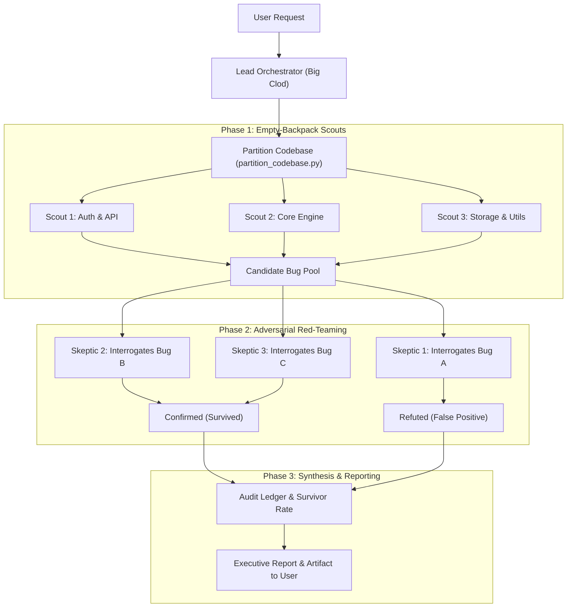

# Skeptic Bug Hunter: Dynamic Multi-Agent Code Audit

This skill implements the **Scouts & Skeptics Dynamic Workflow** benchmarked by Anthropic (finding 66 out of 70 deeply hidden bugs across 116,000 lines of code, versus only 14–27 found by a single agent).

---

## The Core Philosophy: Why Single Agents Fail

1. **The Context "Backpack" Problem**:  
   When a single agent reads a large codebase, every file goes into the same context window. When the window fills up, the agent summarizes to make room. Each summary drops details; by file 400, the agent has lost track of the original objective.
2. **Authorship & Confirmation Bias**:  
   When an agent reviews its own candidate bugs, it is biased toward defending them because it formulated them.
3. **Premature Stopping & Fatigue**:  
   Around bug 15 or 20, the remaining files feel "done enough" to the agent, causing it to plant its flag early and leave dozens of critical bugs undiscovered.

### The Solution: Dynamic Multi-Agent Workflow
- **Lead Agent ("Big Clod")**: Orchestrates the program, maintains the bug ledger, manages token and agent budgets, and stays responsive to the user.
- **Phase 1: Scout Agents (Empty Backpacks)**: The codebase is partitioned into discrete chunks. Each chunk is given to an independent scout subagent with a **fresh, empty context window** to hunt for defects without historical baggage.
- **Phase 2: Skeptic Agents (Adversarial Refutation)**: Every candidate bug is handed to a brand-new skeptic subagent whose **only job is to prove the claim wrong**. Because the skeptic did not author the claim, it has zero reason to defend it.
- **Result**: Surviving bugs are real, high-confidence defects with verified repro triggers and zero hallucinated false positives.



---

## Step-by-Step Workflow Instructions

When this skill is activated, follow these steps systematically:

### Step 0: Scope & Budget Definition

1. **Identify the target scope**:
   - Entire workspace, a specific directory (e.g. `src/`), or recent git diff.
2. **Establish Agent & Token Budget**:
   - Default budget: 3–6 Scout partitions, maximum 15–20 Skeptic verifications.
   - For massive repositories, prompt or notify the user before running more than 10 scouts.
3. **Run the partitioner script**:
   Execute the bundled helper script to inspect lines of code and generate balanced partitions:
   ```powershell
   python .agents/skills/skeptic-bug-hunter/scripts/partition_codebase.py --root . --target-lines 2500 --json-out partitions.json
   ```
   *(Or inspect the directory structure manually if the repository is small).*

---

### Step 1: Phase 1 — Dispatch Scout Agents (Parallel Bug Hunting)

For each code partition, spawn a scout subagent using `invoke_subagent`.

> [!IMPORTANT]
> Keep the scout prompt focused exclusively on its assigned files. Provide the exact system instructions from [references/scout_prompt.md](references/scout_prompt.md).

#### Example `invoke_subagent` Call:
```json
{
  "Subagents": [
    {
      "TypeName": "research",
      "Role": "Bug Scout - Core Backup",
      "Model": "inherit",
      "Prompt": "You are a Bug Scout with an empty backpack. Thoroughly audit only the following files for real defects, concurrency race conditions, resource leaks, and logic errors:\n- src/atlas/backup/archive.py\n- src/atlas/backup/attribute.py\n\nFollow the instructions in .agents/skills/skeptic-bug-hunter/references/scout_prompt.md. Do not stop early. Format all findings using the [CANDIDATE-BUG-XX] schema."
    },
    {
      "TypeName": "research",
      "Role": "Bug Scout - UI Display",
      "Model": "inherit",
      "Prompt": "You are a Bug Scout with an empty backpack. Thoroughly audit only the following files for real defects, concurrency race conditions, and UI crashes:\n- src/atlas/display/controller.py\n- src/atlas/display/popup.py\n\nFollow the instructions in .agents/skills/skeptic-bug-hunter/references/scout_prompt.md. Format all findings using the [CANDIDATE-BUG-XX] schema."
    }
  ]
}
```

- When scouts return, collect all candidate bug reports into an in-memory or scratch pool.
- Assign each a unique ID (e.g., `CANDIDATE-01`, `CANDIDATE-02`).

---

### Step 2: Phase 2 — Dispatch Skeptic Agents (Adversarial Refutation)

For **every** candidate bug identified by the scouts, spawn a fresh skeptic subagent.

> [!CAUTION]
> The skeptic must be instructed to **attempt to prove the bug wrong**. It must never be told that the claim is correct. Provide the instructions from [references/skeptic_prompt.md](references/skeptic_prompt.md).

#### Example Skeptic `invoke_subagent` Call:
```json
{
  "Subagents": [
    {
      "TypeName": "research",
      "Role": "Bug Skeptic - CANDIDATE-01",
      "Model": "inherit",
      "Prompt": "You are an adversarial Bug Skeptic. Your sole job is to PROVE THIS BUG CLAIM WRONG:\n\nCandidate Claim: In src/atlas/display/popup.py, get_active_window() may return None causing an unhandled AttributeError.\n\nCheck all callers, decorators, and window managers. Follow the instructions in .agents/skills/skeptic-bug-hunter/references/skeptic_prompt.md. State your verdict clearly as REFUTED or CONFIRMED with evidence."
    }
  ]
}
```

- If a skeptic finds that upstream guards, middleware, caller constraints, or framework contracts prevent the bug:  
  `VERDICT: REFUTED` (Knocked down as a false positive).
- If the skeptic exhausts all defenses and confirms the failure is real and triggerable:  
  `VERDICT: CONFIRMED` (Survived red-teaming).

---

### Step 3: Phase 3 — Verdict Reconciliation & Report Synthesis

Assemble the findings into the final audit ledger:
1. **Calculate Survivor Statistics**:
   - `Scouts Dispatched`: Total scout subagents.
   - `Candidate Claims Found`: Total initial issues reported.
   - `Skeptics Knocked Down (Refuted)`: False positives eliminated.
   - `Survived Bugs (Confirmed)`: Legitimate defects verified.
   - `Survival Rate`: `(Survived / Candidate Claims) * 100%`.
2. **Rank Surviving Bugs**:
   - Critical: Remote execution, data corruption, infinite loops/deadlocks, security bypasses.
   - High: Unhandled exceptions on user paths, memory leaks, lost state.
   - Medium: Logic boundary flaws, wrong error codes, missing edge-case validation.
   - Low / Flaky: Non-fatal timing anomalies, benign warnings.
3. **Document Knocked-Down Claims**:
   - Include why they were disproven so the user has full transparency on what was checked and why it is safe.

---

### Step 4: Deliver Findings to User

1. Output a clear summary directly in chat highlighting the top critical/high surviving bugs.
2. For in-depth audits, write a comprehensive report artifact to `<appDataDir>/brain/<conversation-id>/audit_report.md` detailing:
   - File locations with clickable links (`file:///...#L123-L145`)
   - Verified trigger scenarios
   - Skeptic confirmation proof
   - Recommended surgical code patches

---

## Best Practices & Guidelines

- **Never summarize between phases**: Pass full candidate snippets and skeptic proofs verbatim so subtle details are never lost.
- **Respect Concurrency**: Dispatch scouts in batches of 3–5 to avoid overwhelming local resources.
- **Model Selection**: Use `flash` or `inherit` for quick lookups and scouts; use `pro` or `inherit` for subtle skeptic refutation analysis.
- **Always preserve false positive logs**: Showing knocked-down bugs builds immense user confidence by demonstrating that the audit actually verified claims rather than blindly trusting hallucinations.
